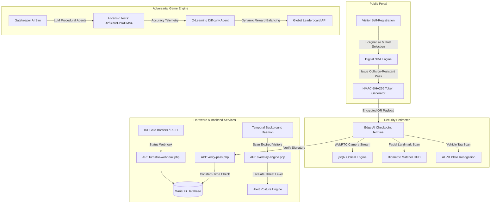

# 🛡️ GatePass Pro (Nexus GPMS)

> **Enterprise Physical Identity & Visitor Access Management System (VAMS) with Edge AI Vision Checkpoint Terminal and Adversarial Reinforcement Learning Simulator.**


---

## 📌 Executive Overview

**GatePass Pro** is a physical security management platform combining **Enterprise Access Control (VAMS)** with an **AI Checkpoint Simulation Game**. 

It transitions conventional, paper-bound security checkpoints into a cryptographic zero-trust perimeter utilizing collision-resistant HMAC-SHA256 digital tokens, live Edge AI optical recognition HUDs, IoT turnstile telemetry webhooks, and an interactive Q-Learning adversarial checkpoint trainer.

---

## 🏛️ System Architecture



---

## ✨ Core Feature Highlights

### 1. 🔐 Cryptographic Pass Issuance & Zero-Trust Verification
* **HMAC-SHA256 Digital Sealing**: Passes are cryptographically signed over `(pass_number, idcardno, todate, category)` using an enterprise secret key.
* **Tamper Proofing**: Modifying expiration dates, altering categories, or swapping badges invalidates the cryptographic hash instantly via `hash_equals()`.
* **High-Density Encrypted QR**: Embeds full security clearance metadata, visitor identity, host approval, and digital hash into a scannable token.

### 2. 👁️ Edge AI & Computer Vision Checkpoint Terminal
* **In-Browser WebRTC Optical Scanner**: Scans QR codes from physical paper passes or mobile screens at sub-100ms latency.
* **Biometric Facial Recognition HUD**: Real-time facial bounding box detector, feature extractor animation, and confidence percentage matching.
* **ALPR (Automated License Plate Recognition)**: Optical vehicle plate verification against travel manifests.
* **Rapid Operator Dispatch**: Single-click access approval, security escalation, or check-out clearance.

### 3. 🌐 IoT Hardware & Turnstile Webhook Controller
* **Turnstile Integration API**: Standardized JSON webhooks for hardware barriers, optical flap gates, and solenoid locks (`ENTRY_GATE_01`, `EXIT_GATE_01`, `VIP_LOBBY_01`).
* **Enforced State Machine**: Prevents double-entry and unauthorized exit (`Approved` ➔ `Checked-In` ➔ `Checked-Out`).

### 4. ⏱️ Overstay Anomaly Detection Engine
* **Temporal Background Scanner**: Identifies visitors remaining in secure facilities beyond authorized pass expiration.
* **Dynamic Threat Posture**: Automatically recalculates site security threat levels (`GREEN` ➔ `AMBER` ➔ `RED`) based on active security alerts and breaches.

### 5. ✍️ Self-Service Pre-Registration & Digital NDA Portal
* **Digital NDA Signature Pad**: Touch/stylus/mouse HTML5 canvas signature capture with Base64 PNG encryption.
* **Instant Digital Dossier**: Visitors generate their own authenticated pass with printable badge layout before physical arrival.

### 6. 🎮 "Gatekeeper" Adversarial Checkpoint AI Simulator
* **Adversarial Agent Personas**: Procedurally generated diplomatic delegates, undercover spies, and rogue contractors with deceptive dialogue.
* **Forensic Inspection Tools**:
  * 🔦 **UV Lamp**: Exposes hidden watermarks or missing fluorescent seals.
  * 🧬 **Biometric Sensor**: Cross-references retina and face data against registry records.
  * 🚗 **Vehicle Plate Matcher**: Flags fake or unlisted license plates.
  * 🔑 **HMAC Cryptographic Verifier**: Mathematically validates digital signatures.
* **Q-Learning RL Difficulty Controller**:
  * Real-time Reinforcement Learning algorithm ($Q(s, a) \leftarrow Q(s, a) + \alpha [R + \gamma \max Q(s', a') - Q(s, a)]$) that dynamically scales adversary deception based on player accuracy.
  * Live Q-Table Telemetry HUD displaying state-action values.

---

## 🔌 REST API Endpoints

| Endpoint | Method | Description |
| :--- | :---: | :--- |
| `/api/verify-pass.php` | `POST` | Validates HMAC signature, clearance level, and pass validity. |
| `/api/checkpoint-action.php` | `POST` | Records operator action (`CHECKIN`, `CHECKOUT`, `FLAGGED`, `TURNSTILE_ENTRY`). |
| `/api/turnstile-webhook.php` | `POST` | Hardware turnstile webhook to unlock barriers or trigger lockouts. |
| `/api/overstay-engine.php` | `GET/POST`| Scans active visitors, flags overstay anomalies, and returns telemetry. |
| `/api/telemetry.php` | `GET` | Live dashboard metrics feed (active visitors, alerts, threat level). |
| `/api/leaderboard.php` | `GET/POST`| Retrieves and submits Gatekeeper Simulator high scores. |

---

## 🛠️ Tech Stack

* **Backend**: PHP (Object-Oriented & Procedural Architecture)
* **Database**: MariaDB / MySQL
* **Frontend**: Vanilla JavaScript (ES6+), HTML5 Canvas, Modern CSS Glassmorphism
* **Libraries / Protocols**:
  * `jsQR.js` — Client-side camera QR barcode processing
  * `qrcode.js` — Client-side cryptographic QR generation
  * `FontAwesome 6` & `Google Fonts` (Poppins, Orbitron, Share Tech Mono)

---

## 🚀 Getting Started

### Prerequisites
* [XAMPP](https://www.apachefriends.org/) (Apache 2.4+ and MariaDB 10.4+)
* PHP 7.4 or PHP 8.x

### Installation Steps

1. **Clone the Repository**
   ```bash
   git clone https://github.com/<your-username>/gatepass-pro.git
   ```

2. **Move into your local web root**
   ```bash
   # Move into XAMPP htdocs
   mv gatepass-pro C:/xampp/htdocs/getpass
   ```

3. **Database Setup**
   * Start **Apache** and **MySQL** via XAMPP Control Panel.
   * Open `http://localhost/phpmyadmin/`.
   * Create a new database named `getpassdb`.
   * Import the file:
     ```bash
     c:/xampp/htdocs/getpass/database/getpassdb.sql
     ```
   * *Alternatively*, navigate to:
     ```
     http://localhost/getpass/database/migrate.php
     ```
     to auto-execute schema migrations and seed pre-configured records.

4. **Verify Database Configuration**
   * Inspect [`db.php`](file:///c:/xampp/htdocs/getpass/db.php):
     ```php
     define('DB_SERVER', 'localhost');
     define('DB_USERNAME', 'root');
     define('DB_PASSWORD', '');
     define('DB_NAME', 'getpassdb');
     ```

5. **Launch the System**
   * **Admin Command Center**: [http://localhost/getpass/index.php](http://localhost/getpass/index.php)
   * **Self-Service Pre-Registration**: [http://localhost/getpass/self-register.php](http://localhost/getpass/self-register.php)
   * **AI Checkpoint Terminal**: [http://localhost/getpass/checkpoint-terminal.php](http://localhost/getpass/checkpoint-terminal.php)
   * **Gatekeeper Simulator**: [http://localhost/getpass/gatekeeper-sim.php](http://localhost/getpass/gatekeeper-sim.php)

---

## 🔑 Default Credentials & Test Passes

### Administrator Credentials
* **Username**: `admin`
* **Password**: `admin`

### Pre-Seeded Passes for Demonstration
* **Pass `#918237465`** — *Dr. Vikramaditya Rao*  
  *(Clearance: Secret • ALPR: `DL-08-AX-9942` • Valid HMAC signature)*
* **Pass `#845920138`** — *Elena Rostova*  
  *(Clearance: VIP Delegate • ALPR: `DL-04-CX-8192` • Valid HMAC signature)*
* **Pass `#682109789`** — *Ram Kumar*  
  *(Flagged / Overstay Anomaly • Expired pass to demonstrate temporal alarm)*

---

## 📄 License
This project is open-source and available under the [MIT License](LICENSE).
